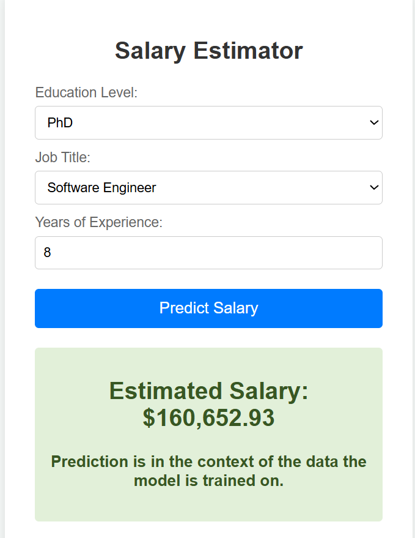

# Serverless Salary Estimator App

A production-ready, zero-cost serverless machine learning application that predicts salaries based on professional demographics and experience. Built with a decoupled architecture featuring a React.js frontend and a containerized FastAPI backend deployed on AWS Lambda.

# Tech Stack
* Python
* FastAPI
* React
* React
* AWS ECR
* Scikit-Learn

# Application Preview

  
  
<em>React frontend displaying real-time salary prediction results from the AWS Lambda FastAPI backend.</em>

# Architecture & Cost Strategy

* Frontend: Static React.js application communicating via REST API
* Backend: FastAPI running inside a AWS Lambda container via the `Mangum` adapter
* ML Core: Scikit-learn pipeline serialized with `joblib`, featuring automated data hygiene and a `RandomForestRegressor`
* Cost Optimization: Leverages permanent lifetime free tiers (AWS Lambda: 1M requests/mo + 3.2M compute seconds) for $0/month maintenance.

# Project Structure

salary-estimator-app/
├── salary_data.csv
│   
├── frontend/
│   ├── public/
│   │   └── index.html
│   ├── src/
│   │   ├── pages/
│   │   │   └── Home.js
│   │   ├── App.css
│   │   └── index.js
│   └── package.json
├── models/
│   └── salary_pipeline.joblib
├── notebooks/
│   └── training.ipynb
├── src/
│   ├── __init__.py
│   └── pipeline.py
├── tests/
│   └── test_app.py
├── app.py
├── Dockerfile
├── requirements.txt
└── README.md

# Data Schema & Modeling Approach

The model trains on structured tabular data (`salary.csv`) available at https://drive.google.com/file/d/13SHaCp3_p7q1N6zT1Tkfi_7Zn-n1mz9-/view?usp=sharing. The dataset contains the following features:

Age (Numeric)

Gender (Categorical / Nominal)

Education (Categorical / Ordinal)

Job Title (Categorical / Ordinal)

Years of Experience (Numeric)

Salary (Target Variable)

Encoding Strategy:
Following our architecture rules, categorical and ordinal features (including Job Title and Education) are handled directly via One-Hot Encoding (OneHotEncoder). Because the underlying algorithm is a tree-based ensemble (RandomForestRegressor), the trees naturally evaluate categorical splits and thresholds efficiently without requiring manual ordinal integer mapping.

 Local Development & Setup
1. Stup Backend Environment

# Install Python dependencies
pip install -r requirements.txt

# Train and serialize the machine learning pipeline
python src/pipeline.py

# Run unit tests
pytest

2. Run FastAPI Locally
uvicorn app:app --reload --port 8000

3. Run React Frontend Locally
cd frontend
npm install
npm start

The React app will run on http://localhost:3000 and point to your local FastAPI server on port 8000.

# Docker & AWS Lambda Deployment
Build the Docker Image:
docker build -t salary-app

### Test Container Locally
Start the Docker container:
docker run -p 9000:8080 salary-app

Invoke the endpoint locally:
curl -X POST "http://localhost:9000/2015-03-31/functions/function/invocations" \
  -H "Content-Type: application/json" \
  -d '{
    "version": "2.0",
    "routeKey": "POST /predict",
    "rawPath": "/predict",
    "requestContext": {
      "http": {
        "method": "POST",
        "path": "/predict"
      }
    },
    "headers": {
      "content-type": "application/json"
    },
    "body": "{\"Education Level\": \"Bachelor's\", \"Job Title\": \"Software Engineer\", \"Years of Experience\": 3.0}",
    "isBase64Encoded": false
  }'

Authenticate Docker with Amazon ECR:
aws ecr get-login-password --region <your region> | docker login --username AWS --password-stdin <your-aws-account-id>.dkr.ecr.<your region>.amazonaws.com

Create your ECR repository (if it doesn't exist):
aws ecr create-repository --repository-name salary-app --image-scanning-configuration scanOnPush=true --region <your region>

Tag your local Docker image:
docker tag salary-app:latest <your-aws-account-id>[.dkr.ecr.<your region>.amazonaws.com/salary-app:latest](https://.dkr.ecr.<your region>.amazonaws.com/salary-app:latest)

Push the image to ECR:
docker push <your-aws-account-id>[.dkr.ecr.<your region>.amazonaws.com/salary-app:latest](https://.dkr.ecr.<your region>.amazonaws.com/salary-app:latest)

Create the Lambda function (Run this if the function does not exist yet):
aws lambda create-function \
  --function-name salary-app \
  --package-type Image \
  --code ImageUri=<your-aws-account-id>.dkr.ecr.<your region>.amazonaws.com/salary-app:latest \
  --role arn:aws:iam::<your-aws-account-id>:role/<your-lambda-execution-role> \
  --region <your region>

OR

Update an existing Lambda function with your new ECR image:
--function-name salary-app \
  --image-uri <your-aws-account-id>.dkr.ecr.<your region>.amazonaws.com/salary-app:latest \
  --region <your region>

Create a Function URL with Auth type set to NONE (for direct public HTTPS access):
aws lambda create-function-url-config \
  --function-name salary-app \
  --auth-type NONE \
  --region <your region>

Grant public invocation permission (Required when Auth type is NONE to prevent 403 Forbidden errors):
aws lambda add-permission \
  --function-name salary-app \
  --statement-id FunctionURLAllowPublicAccess \
  --action lambda:InvokeFunctionUrl \
  --principal "*" \
  --function-url-auth-type NONE \
  --region <your region>

Point your React frontend POST requests directly to your FastAPI backend's '/predict' endpoint hosted on AWS Lambda.